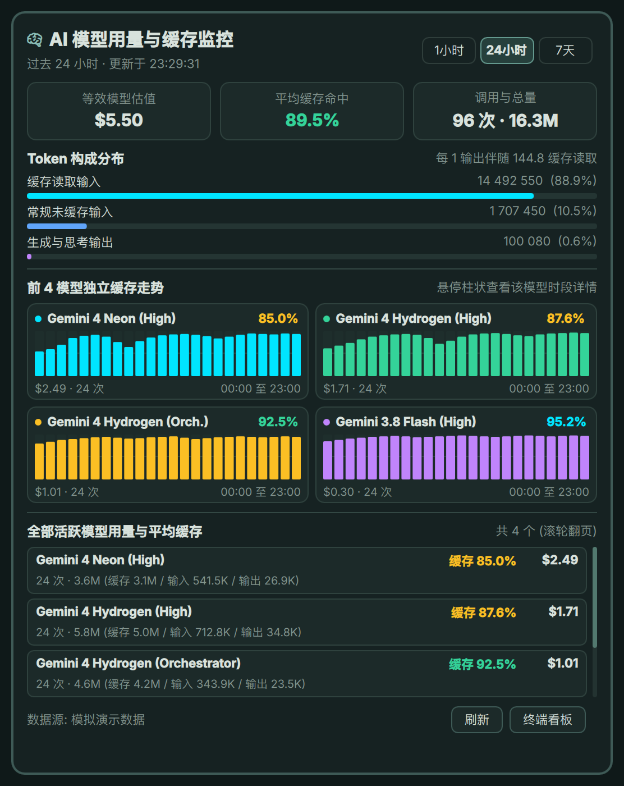
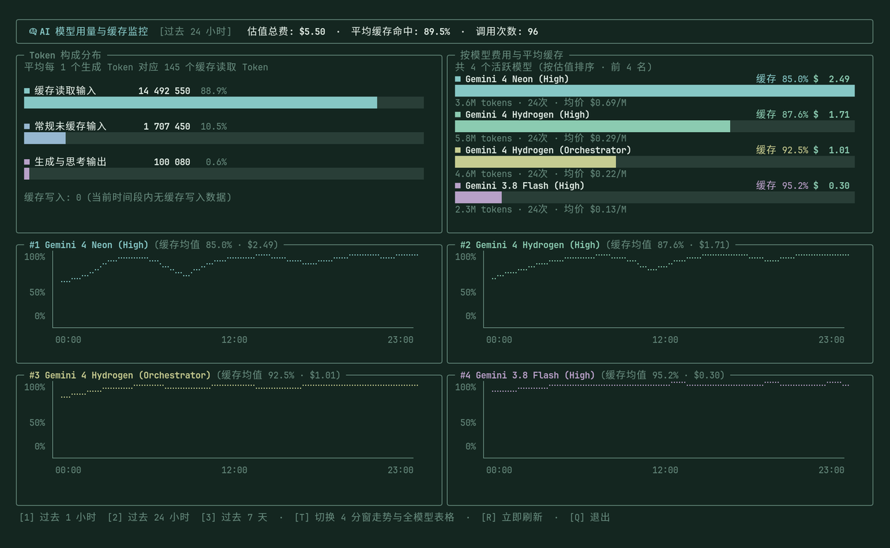

# omarchy-ai-stats

[](VERSION)
[](LICENSE)
[](#)

专为 **Omarchy（Quickshell + Hyprland）** 与 Waybar 打造的本地 AI 模型用量、费用估值与 Prompt Caching 缓存命中率实时监控插件。默认全中文界面，聚焦**过去 24 小时**真实消耗与各主力模型分窗缓存走势。

---

## 📸 UI 预览

### 1. Omarchy 顶栏状态与点击弹出卡片（PopupCard）

左键点击顶栏图标平滑弹出详情卡片，再次点击（或点击桌面其他区域）自动平滑收回；右键点击立即刷新数据。


<p align="center">
  
</p>

### 2. 全中文交互式终端看板（TUI Dashboard）

点击卡片底部「终端看板」或直接在终端运行 `omarchy-ai-stats`，右上角展示前 4 主力模型费用与平均缓存命中率，底部以 `2×2` 四分窗独立展示各模型分时段平滑趋势。



---

## ✨ 核心特性

- **点击即弹、再点收回的原生桌面体验**：基于 Omarchy Shell 原生 `PopupCard` 构建，自动跟随当前 Omarchy 主题色、圆角与磨砂玻璃特效，告别独立弹窗遮挡。
- **过去 24 小时默认聚合 + 多时间段切换**：顶栏、弹出卡片及终端看板默认统计过去 24 小时，支持一键切换 `1 小时`、`24 小时`、`7 天`。
- **前 4 模型分窗独立走势**：不再把不同模型混在一条曲线里导致波动失真；主界面将前 4 名主力模型切割为 4 个独立小窗，按自然整点 / 整刻度时间桶固定对齐，历史时段数值静态锁定不跳动。
- **全本地多 Agent 日志直采**：零额外代理侵入，直接读取本地 SQLite / JSONL 日志：
  - **Antigravity IDE / CLI**（原生 Protobuf 解码 `~/.gemini/antigravity/conversations/*.db` 及其实时 WAL 日志）
  - **OMP (`oh-my-pi`)**（`~/.omp/stats.db`）
  - **Devin CLI**（`~/.local/share/devin/cli/sessions.db`，内置消息去重）
  - **Claude Code**（`~/.claude/projects/**/*.jsonl`）
  - **Codex CLI**（`~/.codex/sessions/**/*.jsonl`）
  - **OpenCode**（`~/.local/share/opencode/opencode.db`）
  - **Pi Agent**（`~/.pi/agent/sessions/**/*.jsonl`）
  - **通用自定义日志**（`~/.local/share/ai-usage/events.jsonl`）
- **权威模型单价与可滚动明细**：内置标准模型单价配置（`~/.config/omarchy-ai-stats/pricing.json`），支持查看全部活跃模型的调用次数、缓存读取、常规输入、生成输出与平均缓存命中率。
- **Waybar 兼容**：同时附带 Waybar 模块配置与 CSS 样式，方便非 Omarchy Shell 的 Hyprland 用户使用。

---

## 🚀 快速安装

### 一键克隆并安装

```bash
git clone https://github.com/dunova/omarchy-ai-stats.git
cd omarchy-ai-stats
./scripts/install.sh
```

`install.sh` 将自动完成以下步骤：
1. 检查并安装依赖 `python-rich`；
2. 将主程序安装至 `~/.local/bin/omarchy-ai-stats`，复制默认单价表至 `~/.config/omarchy-ai-stats/pricing.json`；
3. 自动检测 Omarchy Shell，安装原生顶栏插件至 `~/.config/omarchy/plugins/<user>.ai-stats/`，挂载到顶栏右侧并执行重载；
4. 若检测到 `~/.config/hypr/hyprland.lua` 或 `windows.conf`，自动备份并写入终端看板浮窗规则；
5. 运行 `omarchy-ai-stats --check` 验证本机数据源采集情况。

### Waybar 用户手动接入（可选）

如果您的环境使用的是 Waybar 而非 Omarchy Shell，请备份 `~/.config/waybar/config.jsonc` 后，将 [config/waybar-module.jsonc](./config/waybar-module.jsonc) 中的 `"custom/ai-usage"` 模块加入顶栏配置，并将 [config/waybar-style.css](./config/waybar-style.css) 追加到 `~/.config/waybar/style.css`。

---

## ⌨️ 操作与快捷键

- **顶栏插件**：
  - **左键点击**：弹出 / 收回详情卡片
  - **右键点击**：立即手动刷新统计
  - **悬停趋势柱**：实时查看该时段时刻、缓存命中率与 Token 吞吐量
- **终端 TUI 看板（`omarchy-ai-stats`）**：
  - `omarchy-ai-stats --demo`：使用内置 24 小时模拟数据预览界面
  - `omarchy-ai-stats --check`：诊断本机各数据源检测到的调用数量与状态
  - `1` / `2` / `3`：切换 `过去 1 小时` / `过去 24 小时` / `过去 7 天`
  - `t`：在 `4 分窗走势图` 与 `全模型数据明细表` 之间切换
  - `r`：立即刷新数据
  - `q` / `Esc`：退出终端看板

---

## ⚙️ 单价表与自定义日志接入

### 自定义模型单价

编辑 `~/.config/omarchy-ai-stats/pricing.json`（单位：美元 / 百万 Token，数组依次为 `[未缓存输入, 缓存读取, 缓存写入, 生成输出]`）：

```json
{
  "gemini-4-hydrogen": [1.50, 0.075, 0.00, 7.50],
  "gemini-4-neon": [3.00, 0.15, 0.00, 15.00],
  "gemini-3.8-flash": [0.75, 0.075, 0.00, 3.75],
  "claude-opus-5.5": [4.00, 0.20, 5.00, 20.00]
}
```

### 接入第三方代理或自定义脚本

向 `~/.local/share/ai-usage/events.jsonl` 逐行追加 JSON 事件即可实时统计：

```json
{"ts": "2026-11-20T23:10:00+08:00", "model": "gemini-4-hydrogen", "cached": 185000, "uncached": 12400, "cache_write": 0, "output": 820}
```

---

## 🗑️ 卸载

```bash
cd omarchy-ai-stats
./scripts/uninstall.sh
```

---

## 📄 开源协议

本项目基于 [MIT License](./LICENSE) 开源发布，当前版本 `v0.1.1`。
